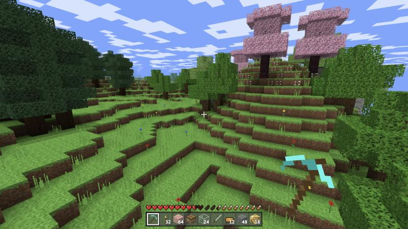
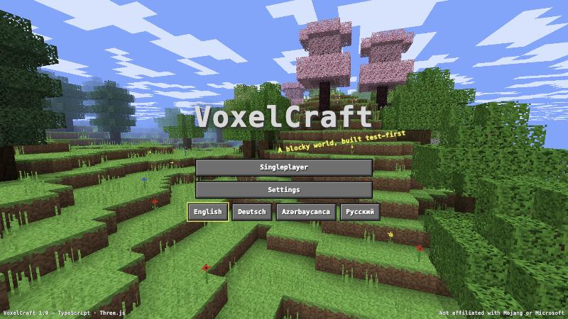
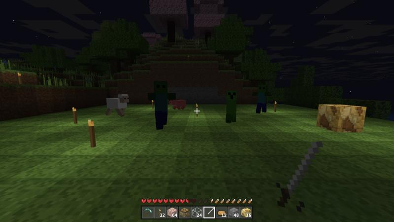
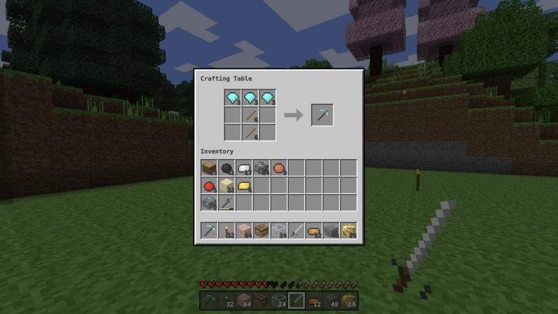
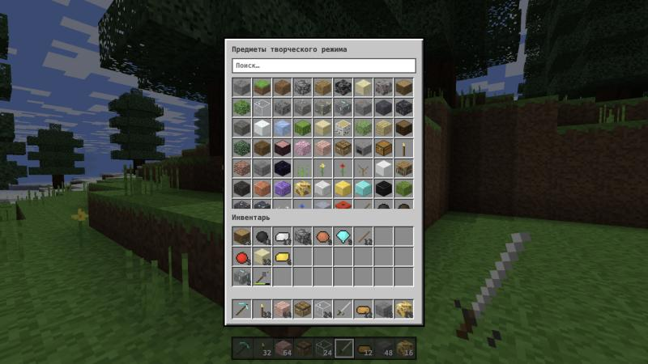
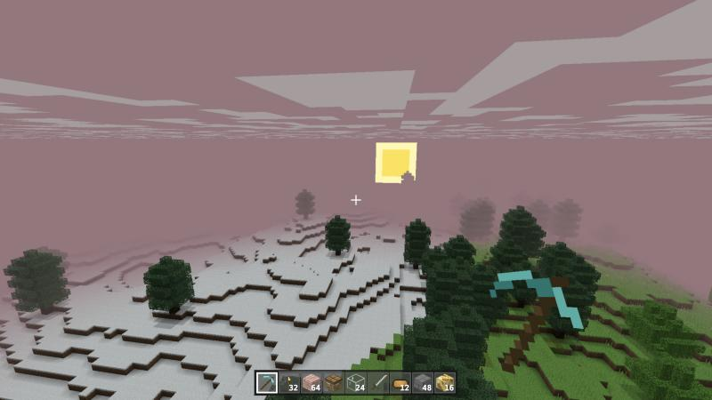
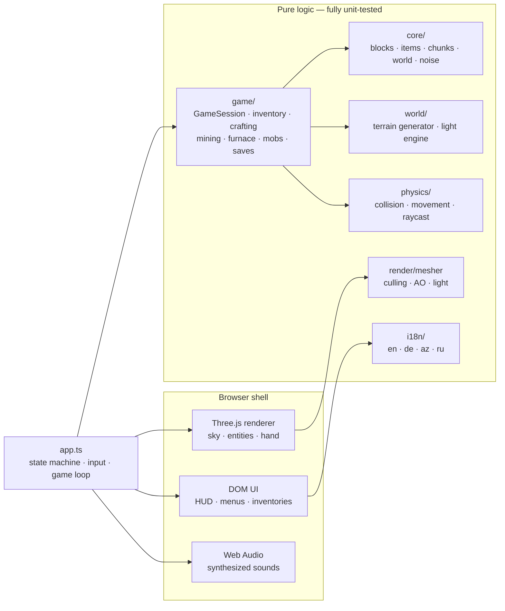

<div align="center">

# ⛏️ VoxelCraft

### A Minecraft-inspired voxel sandbox for the browser — built test-first, rendered in Three.js, playable in four languages.

[](https://elkhan-isayev.github.io/minecraft/)
[](https://github.com/Elkhan-Isayev/minecraft/actions)


<br>



<sub><i>Survival mode at noon — terraced hills rolling up into a cherry grove.</i></sub>

</div>

---

## ✨ Highlights

<table>
<tr>
<td width="50%" valign="top">

**🌍 An endless, seeded world**<br>
Twelve biomes — from snowy peaks and spruce taiga to deserts, swamps and the 1.20 **cherry grove** — carved by spaghetti caves and cheese caverns, layered with deepslate and tuff, and seeded with coal, iron, copper, gold and diamond.

</td>
<td width="50%" valign="top">

**💡 Real voxel lighting**<br>
A flood-fill light engine with separate sky and block light, smooth day/night, warm torchlight, glowing glowstone, per-vertex ambient occlusion, stars, drifting clouds and pink sunsets.

</td>
</tr>
<tr>
<td valign="top">

**⚔️ Survival that bites**<br>
Health, hunger and saturation, fall damage and drowning, tool tiers and break times that follow Minecraft's own formula, zombies that burn at dawn and creepers that leave craters.

</td>
<td valign="top">

**🛠️ Crafting & smelting**<br>
2×2 and 3×3 crafting with 50+ shaped, shapeless and mirrored recipes, a fuel-burning furnace, chests that remember their contents, and a creative inventory with live, localized search.

</td>
</tr>
<tr>
<td valign="top">

**🎨 Zero external assets**<br>
Every texture is painted in code, pixel by pixel. Every sound — footsteps, block breaks, explosions — is synthesized live with the Web Audio API. Nothing is copied from the original game.

</td>
<td valign="top">

**🧪 Built test-first**<br>
272 unit tests across 19 suites pin down terrain, light, physics, crafting, mobs, saving and the full game loop. The whole suite runs in about four seconds.

</td>
</tr>
</table>

## 📸 Gallery

<table>
<tr>
<td></td>
<td></td>
</tr>
<tr>
<td align="center"><sub>A live 3D panorama behind the title screen</sub></td>
<td align="center"><sub>Nightfall: torches, zombies and a creeper</sub></td>
</tr>
<tr>
<td></td>
<td></td>
</tr>
<tr>
<td align="center"><sub>Crafting a diamond pickaxe</sub></td>
<td align="center"><sub>The creative inventory — in Russian</sub></td>
</tr>
<tr>
<td colspan="2"></td>
</tr>
<tr>
<td colspan="2" align="center"><sub>Sunset over the snowy taiga</sub></td>
</tr>
</table>

## 🚀 Getting started

**Play instantly:** **[elkhan-isayev.github.io/minecraft](https://elkhan-isayev.github.io/minecraft/)** — runs in any modern desktop browser with WebGL (tested in Safari and Chromium).

**Run it locally on a Mac:** double-click **`Play VoxelCraft.command`** in Finder. It installs dependencies on first launch, builds the game and opens it in your browser. *(First time only: right-click → Open to approve the script.)*

**Or from a terminal** (requires [Node.js](https://nodejs.org) 18+):

```bash
npm install
npm run dev        # start the dev server and open the game
npm test           # run the unit-test suite
npm run build      # type-check and produce an optimized build in dist/
npm run preview    # serve the production build
```

## 🎮 Controls

| Input | Action |
| :--- | :--- |
| <kbd>W</kbd> <kbd>A</kbd> <kbd>S</kbd> <kbd>D</kbd> | Move |
| <kbd>Space</kbd> | Jump · swim up · fly up |
| <kbd>Shift</kbd> | Sneak (you won't fall off edges) · fly down |
| <kbd>Ctrl</kbd> or double-tap <kbd>W</kbd> | Sprint |
| **Left click** (hold) | Break blocks · attack |
| **Right click** | Place · open crafting table, furnace or chest · eat · ignite TNT |
| **Middle click** | Pick block |
| <kbd>1</kbd>–<kbd>9</kbd> · mouse wheel | Select hotbar slot |
| <kbd>E</kbd> | Inventory |
| <kbd>Q</kbd> · <kbd>Ctrl</kbd>+<kbd>Q</kbd> | Drop one item · drop the whole stack |
| Double-tap <kbd>Space</kbd> | Toggle flight *(creative)* |
| <kbd>G</kbd> | Switch between survival and creative |
| <kbd>F3</kbd> *(<kbd>fn</kbd>+<kbd>F3</kbd> on a Mac)* | Debug overlay |
| <kbd>Esc</kbd> | Pause |

**In inventories:** left click picks up or places a stack, right click splits it or places a single item, and <kbd>Shift</kbd>+click moves it instantly (or crafts as many as possible).

## 🌐 Languages

Switch language from the title screen or the settings at any time — every menu, item, biome and death message updates live. The browser's language is detected on first launch.

| | Language | Example |
| :---: | :--- | :--- |
| 🇬🇧 | English | *Diamond Pickaxe* · *Cherry Grove* · *You were slain by Zombie* |
| 🇩🇪 | Deutsch | *Diamantspitzhacke* · *Kirschblütenhain* · *Du wurdest von Zombie getötet* |
| 🇦🇿 | Azərbaycanca | *Almaz kirkə* · *Albalı bağı* · *Sizi Zombi öldürdü* |
| 🇷🇺 | Русский | *Алмазная кирка* · *Вишнёвая роща* · *Вас убил моб: Зомби* |

A test guarantees that all four dictionaries contain exactly the same keys and placeholders, so no language ever falls behind.

## 🧱 What's inside

| | |
| :--- | :--- |
| **Blocks** | 63 — stone, deepslate, tuff, four wood types, ores and their deepslate variants, copper and amethyst blocks, glass, ice, glowstone, TNT, flowers, pink petals… |
| **Items** | 109 — 24 tools across six tiers (wood → netherite), ingots, raw ores, food |
| **Biomes** | Ocean · beach · plains · forest · birch forest · desert · taiga · snowy plains · snowy peaks · windswept hills · cherry grove · swamp |
| **Creatures** | Pig · cow · sheep · zombie · creeper |
| **World** | 128 blocks tall, streamed in 16×16 chunks around the player, with player edits and containers saved per world |

## 🏗️ Under the hood

The game is split into a **pure, headless core** and a thin **presentation shell**. All rules live in plain TypeScript modules with no DOM or WebGL, which is what makes test-first development practical.



- **`GameSession`** is the heart of the game: every player action — mining, placing, crafting, eating, fighting — goes through it, so the integration tests drive it exactly the way the UI does.
- **Terrain** blends continentalness, erosion, temperature and humidity noise, then carves caves and places ores and trees per chunk — deterministic for a given seed and independent of load order.
- **Lighting** is a breadth-first flood fill (sky light and block light in one packed byte per voxel) with incremental add and remove passes when blocks change, propagating across chunk borders.
- **Meshing** copies each 16³ section plus a one-block border into flat arrays, then emits only visible faces, with ambient occlusion and per-vertex light. A custom GLSL shader applies daylight, warm torchlight and distance fog.

### Performance

Measured on a MacBook in a development build:

| Task | Time |
| :--- | ---: |
| Generate one chunk (16 × 128 × 16) | ~2.8 ms |
| Generate and light one chunk | ~5.4 ms |
| Mesh one 16³ section | ~0.6 ms |
| Full frame while sprint-flying through new terrain | ~4.7 ms median |

## 🧪 Test-driven development

Every gameplay module was written red → green: a failing test first, then the code that makes it pass.

| Area | What the tests pin down |
| :--- | :--- |
| `core` | Seeded RNG and simplex noise · block and item registry · chunk storage · world edits · dirty-section tracking |
| `world/terrain` | Determinism · bedrock · sea level · biome variety · deserts · ore depths · deepslate · caves · trees · safe spawn |
| `world/light` | Sunlight and shadows · torch falloff · light removal · walls · cross-chunk propagation · water dimming |
| `physics` | Gravity · fall distance · walk/sprint/sneak speeds · jump height · wall sliding · no tunnelling · ceilings · edge sneaking · swimming · flying · raycasts · bad time steps |
| `game` | Inventory and slot clicks · crafting · mining speed and drops · furnace · health, hunger and air · day cycle · mob AI, combat and spawning · explosions · saves · settings · a full `GameSession` integration suite |
| `render` | Texture atlas · procedural textures · mesher culling, AO, light, water and plants · fast-path equivalence |
| `i18n` | Identical keys and placeholders in all four languages · every block, item and biome is named · fallback · browser language detection |
| `ui` · `input` | HUD icons · tooltips · death messages · shift-click routing · crafting results · creative search · keyboard state machine |

```bash
npm test
#  Test Files  19 passed (19)
#       Tests  272 passed (272)
```

## 🗺️ Roadmap

- [ ] Flowing water and lava, plus buckets
- [ ] Slabs, stairs, doors and beds
- [ ] Directional blocks (furnaces and chests that face the player)
- [ ] Taller worlds (−64 to 320) and more biomes
- [ ] Villages and structures
- [ ] Multiplayer

## ⚖️ Disclaimer

VoxelCraft is an independent fan project inspired by *Minecraft*. It is not affiliated with, endorsed by, or connected to Mojang Studios or Microsoft. *Minecraft* is a trademark of Mojang Synergies AB. All code, textures and sounds in this repository are original.

<div align="center">
<br>
<sub>Made with TypeScript, Three.js, and a lot of red → green.</sub>
</div>
